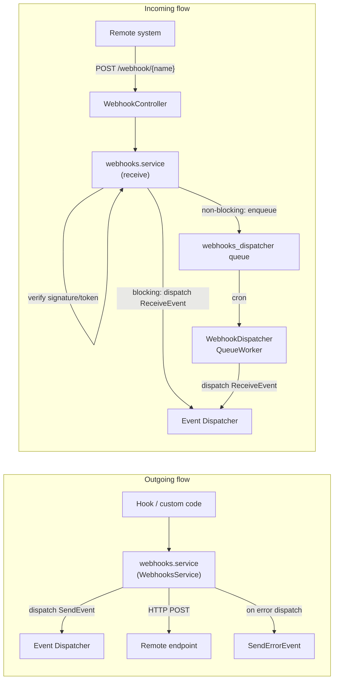

# Developer Guide

This guide covers the integration APIs available in the Webhooks module for
custom module authors: the service layer, event system, payload objects,
signature handling, queue processing, Drush commands, and the optional
`webhook` submodule.

---

## Architecture overview



---

## The `webhooks.service` service

The primary API surface is the `webhooks.service` service, registered in
`webhooks.services.yml`. It implements three interfaces:

| Interface | Responsibility |
|---|---|
| `WebhookDispatcherInterface` | Load configs by event, trigger all subscribers, send a single webhook |
| `WebhookReceiverInterface` | Receive and verify an inbound webhook request |
| `WebhookSerializerInterface` | Encode/decode payloads via Symfony Serializer |

### Injecting the service

```php
use Drupal\webhooks\WebhooksService;

// Via constructor injection (preferred):
public function __construct(
    private readonly WebhooksService $webhooksService,
) {}

// Via the static container (hooks / procedural code):
$webhooksService = \Drupal::service('webhooks.service');
```

### Key methods

#### `loadMultipleByEvent(string $event, string $type = 'outgoing'): WebhookConfigInterface[]`

Returns all active `webhook_config` entities subscribed to `$event`.

```php
$configs = $webhooksService->loadMultipleByEvent('entity:node:create');
```

#### `triggerEvent(Webhook $webhook, string $event): void`

Loads every active outgoing config for `$event` and calls `send()` for each.

```php
use Drupal\webhooks\Webhook;

$webhook = new Webhook(
    ['custom_key' => 'custom_value'],
    [],
    'my_module:custom_event',
    'application/json',
);
$webhooksService->triggerEvent($webhook, 'my_module:custom_event');
```

#### `send(WebhookConfig $webhookConfig, Webhook $webhook): void`

Sends a single webhook to the URL defined in `$webhookConfig`. Dispatches
`WebhookEvents::SEND` before the request and `WebhookEvents::SEND_ERROR` if
the HTTP call throws an exception.

#### `receive(string $name): Webhook`

Validates the incoming request against the active `webhook_config` entity with
machine name `$name`, verifies any signature or token, and either dispatches
`WebhookEvents::RECEIVE` immediately or enqueues the payload for later
processing. If verification fails, the service logs the failure (payload
length only, not the body), dispatches `WebhookEvents::RECEIVE_ERROR`, and
rethrows; `RECEIVE` is not dispatched.

A WooCommerce activation ping (`webhook_id=` plus digits, no
`X-WC-Webhook-*` headers) returns 200 without HMAC verification and
without dispatching `RECEIVE`. Every other request is still verified.

---

## The `Webhook` value object

`Drupal\webhooks\Webhook` is the data transfer object passed between all parts
of the system.

### Constructor

```php
$webhook = new Webhook(
    payload: ['event' => 'my_event', 'data' => ['key' => 'value']],
    headers: [],
    event: 'my_module:my_event',
    content_type: 'application/json',
);
```

### Automatic headers

Certain setters automatically populate the `headers` array:

| Setter | Header set |
|---|---|
| `setEvent(string $event)` | `Webhook-Event` and deprecated `X-Drupal-Event` |
| `setUuid(string $uuid)` | `Webhook-Delivery-Id` and deprecated `X-Drupal-Delivery` |
| `setContentType(string $ct)` | `Content-Type` |
| `setSignature(string $body)` | `X-Hub-Signature` (SHA-1) and `X-Hub-Signature-256` (SHA-256) |

See [Webhook header migration](delivery-header.md) for the metadata
header transition. `getUuid()` and `setUuid()` retain their existing delivery meaning.

### Payload manipulation

Use `setPayload()` to replace the entire payload array, or `addPayload()` to
merge additional top-level keys into the existing payload:

```php
// Replace the entire payload:
$webhook->setPayload(['key' => 'value']);

// Merge additional keys into the existing payload:
$webhook->addPayload(['extra_key' => 'extra_value']);
```

Both methods are available on the `Webhook` object at any point, but the
right place to modify an outgoing payload is inside a `WebhookEvents::SEND`
subscriber — see [Modifying outgoing payloads](#modifying-outgoing-payloads)
below.

Incoming requests also keep the posted bytes on `getBody()` /
`setBody()`. HMAC verification uses that string, not
`json_encode(getPayload())`. Compare SHA-256 or byte length of
`getBody()` / the stored entity `payload` field to the HTTP body;
do not compare pretty-printed JSON.

### Signature generation and verification

```php
// Generating (done automatically by WebhooksService::send when a secret exists):
$webhook->setSecret($secret);
$webhook->setSignature($encodedBody);

// Read a signature from a named header (incoming verification):
$signature = $webhook->getSignature($webhookConfig->getSignatureHeader());

// Verifying an inbound signature:
Webhook::verify(
  $secret,
  $rawRequestBody,
  $signature,
  $webhookConfig->getSignatureAlgorithm()
);
// Pass the posted body string (Webhook::getBody()), never a parse-and-
// re-encode of the decoded array. WooCommerce signs
// trim(wp_json_encode($payload)); the unprefixed path trims the body.
// Hub-style values (sha256=<hex>) use the prefix algorithm and exact
// body bytes. Other values are treated as base64 of a binary HMAC using
// $algorithm.
// Throws WebhookMismatchSignatureException on failure.

// Token verification (legacy):
Webhook::verifyToken($storedToken, $receivedToken);
// Throws WebhookMismatchTokenException on failure.
```

---

## Events

The module dispatches three Symfony events defined in `WebhookEvents`.

### `WebhookEvents::SEND` (`webhook.send`)

Dispatched immediately before an outgoing HTTP request is made. Use this to
inspect or modify the webhook before it is sent.

`WebhookEvents::SEND` fires after the `Webhook` object is constructed but
**before** the payload is encoded and before the HMAC signature is calculated.
Changes made inside this event are reflected in the signed body that reaches
the remote endpoint.

**Event class:** `Drupal\webhooks\Event\SendEvent`

**Available methods:**

| Method | Returns |
|---|---|
| `$event->getWebhook()` | The mutable `Webhook` value object |
| `$event->getWebhookConfig()` | The `WebhookConfig` config entity |

---

#### Modifying outgoing payloads

The subscriber below shows the recommended pattern: check the event or config
to limit changes to the webhooks you intend to affect, then use `addPayload()`
to merge extra keys or `setPayload()` to replace the payload entirely.

```php
use Drupal\webhooks\Event\SendEvent;
use Drupal\webhooks\Event\WebhookEvents;
use Symfony\Component\EventDispatcher\EventSubscriberInterface;

final class MyWebhookSubscriber implements EventSubscriberInterface {

  public static function getSubscribedEvents(): array {
    return [
      WebhookEvents::SEND => 'onWebhookSend',
    ];
  }

  public function onWebhookSend(SendEvent $event): void {
    $webhook = $event->getWebhook();
    $config  = $event->getWebhookConfig();

    // Limit changes to a specific webhook config or event type.
    if ($config->id() !== 'my_outgoing_webhook') {
      return;
    }

    // Read the current payload if you need to inspect it first.
    $payload = $webhook->getPayload();

    // Merge additional top-level keys (leaves existing data intact).
    $webhook->addPayload([
      'site_uuid' => \Drupal::config('system.site')->get('uuid'),
      'env'       => \Drupal::state()->get('my_module.env', 'production'),
    ]);

    // Or replace the payload entirely.
    // $webhook->setPayload(['key' => 'value']);
  }

}
```

---

#### Including referenced entities in the payload

By default, the entity hooks normalize entity reference fields as lightweight
stubs — only the target entity's `id` and `type` are included. If the
receiving system needs the full referenced entity data, load and normalize the
references inside a `WebhookEvents::SEND` subscriber and attach them under an
`included` key, following a pattern similar to JSON:API.

This approach keeps the original entity shape intact and avoids recursion
problems when referenced entities also have references.

```php
use Drupal\Core\Entity\EntityRepositoryInterface;
use Drupal\webhooks\Event\SendEvent;
use Drupal\webhooks\Event\WebhookEvents;
use Symfony\Component\EventDispatcher\EventSubscriberInterface;
use Symfony\Component\Serializer\Normalizer\NormalizerInterface;

final class NodeReferenceExpansionSubscriber
    implements EventSubscriberInterface {

  public function __construct(
    private readonly EntityRepositoryInterface $entityRepository,
    private readonly NormalizerInterface $serializer,
  ) {}

  public static function getSubscribedEvents(): array {
    return [
      WebhookEvents::SEND => 'onWebhookSend',
    ];
  }

  public function onWebhookSend(SendEvent $event): void {
    $webhook = $event->getWebhook();

    // Limit expansion to node entity events.
    if (!str_starts_with($webhook->getEvent(), 'entity:node:')) {
      return;
    }

    $payload = $webhook->getPayload();

    // Resolve the node from the UUID already present in the normalized payload.
    $uuid = $payload['entity']['uuid'][0]['value'] ?? NULL;
    if (!$uuid) {
      return;
    }

    $node = $this->entityRepository->loadEntityByUuid('node', $uuid);
    if (!$node || !$node->hasField('field_related_content')) {
      return;
    }

    // Normalize each referenced entity and attach under 'included'.
    $included = [];
    foreach ($node->get('field_related_content')->referencedEntities()
        as $referenced) {
      $included[] = $this->serializer->normalize($referenced);
    }

    // Merge the expanded data alongside the existing payload.
    $webhook->addPayload(['included' => ['field_related_content' => $included]]);
  }

}
```

Register the subscriber in your module's `services.yml`:

```yaml
# my_module.services.yml
services:
  my_module.node_reference_expansion_subscriber:
    class: Drupal\my_module\EventSubscriber\NodeReferenceExpansionSubscriber
    autowire: true
    tags:
      - { name: event_subscriber }
```

!!! note "Payload size and recursion"
    Loading and normalizing many referenced entities can produce large payloads
    and slow the request. Consider limiting expansion to specific fields or
    bundles, and be mindful of circular references when referenced entities
    themselves contain entity reference fields.

### `WebhookEvents::RECEIVE` (`webhook.receive`)

Dispatched when an inbound webhook passes all verification checks. Use this to
act on the received payload.

**Event class:** `Drupal\webhooks\Event\ReceiveEvent`

```php
use Drupal\webhooks\Event\ReceiveEvent;
use Drupal\webhooks\Event\WebhookEvents;
use Symfony\Component\EventDispatcher\EventSubscriberInterface;

final class MyReceiveSubscriber implements EventSubscriberInterface {

  public static function getSubscribedEvents(): array {
    return [
      WebhookEvents::RECEIVE => 'onWebhookReceive',
    ];
  }

  public function onWebhookReceive(ReceiveEvent $event): void {
    $payload       = $event->getWebhook()->getPayload();
    $webhookConfig = $event->getWebhookConfig();

    // React only to a specific incoming endpoint:
    if ($webhookConfig->id() !== 'github_push') {
      return;
    }

    // Process $payload ...

    // Signal a processing failure to suspend the queue (non-blocking mode):
    // $event->getWebhook()->setStatus(FALSE);
  }

}
```

For a full walkthrough, see
[Process Incoming Webhooks](process-incoming-webhooks.md).

### `WebhookEvents::RECEIVE_ERROR` (`webhook.receive.error`)

Dispatched when inbound signature or token verification fails. Listeners
may log the request for debugging. Do not process the payload here: the
HTTP response remains `401` and `WebhookEvents::RECEIVE` is not dispatched.

Unknown endpoints (`404`) do not fire this event.

**Event class:** `Drupal\webhooks\Event\ReceiveErrorEvent`

```php
use Drupal\webhooks\Event\ReceiveErrorEvent;
use Drupal\webhooks\Event\WebhookEvents;
use Symfony\Component\EventDispatcher\EventSubscriberInterface;

final class MyReceiveErrorSubscriber implements EventSubscriberInterface {

  public static function getSubscribedEvents(): array {
    return [
      WebhookEvents::RECEIVE_ERROR => 'onWebhookReceiveError',
    ];
  }

  public function onWebhookReceiveError(ReceiveErrorEvent $event): void {
    $webhook   = $event->getWebhook();
    $exception = $event->getError();
    // Persist headers/payload for debugging. Do not treat as verified.
  }

}
```

### `WebhookEvents::SEND_ERROR` (`webhook.send.error`)

Dispatched when an outgoing webhook HTTP request throws an exception.

**Event class:** `Drupal\webhooks\Event\SendErrorEvent`

```php
use Drupal\webhooks\Event\SendErrorEvent;
use Drupal\webhooks\Event\WebhookEvents;
use Symfony\Component\EventDispatcher\EventSubscriberInterface;

final class MyErrorSubscriber implements EventSubscriberInterface {

  public static function getSubscribedEvents(): array {
    return [
      WebhookEvents::SEND_ERROR => 'onWebhookSendError',
    ];
  }

  public function onWebhookSendError(SendErrorEvent $event): void {
    $exception     = $event->getException();
    $webhookConfig = $event->getWebhookConfig();
    // Alert, retry, record failure, etc.
  }

}
```

### Registering an event subscriber

Declare the subscriber as a tagged service. Use `autowire: true` so Drupal
resolves constructor dependencies by type hint:

```yaml
# my_module.services.yml
services:
  my_module.webhook_subscriber:
    class: Drupal\my_module\EventSubscriber\MyWebhookSubscriber
    autowire: true
    tags:
      - { name: event_subscriber }
```

---

## Altering available outgoing event options

Modules can add custom events to the event selection table in the
`webhook_config` add/edit form by implementing
`hook_webhooks_event_info_alter()`.

```php
/**
 * Implements hook_webhooks_event_info_alter().
 *
 * @param array $options
 *   Associative array of event options keyed by event machine name. Each
 *   value is an array with 'type' (human-readable label) and 'event'
 *   (machine name) keys.
 */
function my_module_webhooks_event_info_alter(array &$options): void {
  $options['my_module:order_placed'] = [
    'type'  => t('My Module: Order placed'),
    'event' => 'my_module:order_placed',
  ];
  $options['my_module:order_shipped'] = [
    'type'  => t('My Module: Order shipped'),
    'event' => 'my_module:order_shipped',
  ];
}
```

Trigger a custom event from anywhere using `triggerEvent()`:

```php
$webhook = new Webhook(
    ['order_id' => 42, 'status' => 'shipped'],
    [],
    'my_module:order_shipped',
    'application/json',
);
\Drupal::service('webhooks.service')
    ->triggerEvent($webhook, 'my_module:order_shipped');
```

---

## Queue processing

Non-blocking incoming webhooks are stored in the `webhooks_dispatcher` queue.
The `WebhookDispatcher` queue worker plugin processes items during cron,
spending up to 60 seconds per cron invocation.

If the `WebhookEvents::RECEIVE` listener calls
`$event->getWebhook()->setStatus(FALSE)`, the queue worker throws
`SuspendQueueException` so the item is retried on the next cron run rather than
deleted.

### Reliable vs. best-effort queues

The queue backend is chosen at service instantiation time based on the
`webhooks.settings:reliable` configuration value.

| Setting | Queue class | Guarantee |
|---|---|---|
| `reliable: false` (default) | Default queue | Best-effort; order may not be preserved |
| `reliable: true` | Reliable queue | At-least-once; order preserved |

!!! note
    Changing this setting only affects new queue items; existing items continue
    with the previously configured backend until they are processed.

### Queue item structure

Each queue item is an associative array:

```php
[
  'id'      => 'machine_name_of_webhook_config',
  'webhook' => $webhookObject, // \Drupal\webhooks\Webhook instance
]
```

---

## Drush commands

The module provides two Drush commands registered in `drush.services.yml`.

### `webhooks:trigger` (alias: `wt`)

Manually trigger all active outgoing webhooks subscribed to a given event.
Useful for testing or replaying events.

```bash
# Trigger with no payload:
drush webhooks:trigger entity:node:create

# Trigger with a custom JSON payload:
drush webhooks:trigger entity:node:create \
  --payload='{"nid": 1, "title": "Test"}'

# Specify a content type:
drush webhooks:trigger entity:node:create \
  --payload='{"nid": 1}' \
  --content_type='application/json'

# Include custom headers:
drush webhooks:trigger entity:node:create \
  --headers='{"X-Custom-Header": "value"}'
```

**Options:**

| Option | Default | Description |
|---|---|---|
| `--payload` | `''` | JSON-encoded payload body |
| `--headers` | `''` | JSON-encoded additional headers |
| `--content_type` | `application/json` | MIME type for the request body |

### `webhooks:list` (alias: `wt`)

List all webhook configurations with their type and status.

```bash
# List all webhooks:
drush webhooks:list

# Filter by type:
drush webhooks:list --type=outgoing

# Filter by active status (1 = active, 0 = inactive):
drush webhooks:list --status=1
```

**Output fields:** `Name`, `Machine Name`, `Type`, `Status`

---

## The `webhook` submodule

The optional `webhook` submodule (`modules/webhook/`) listens to
`WebhookEvents::RECEIVE` and `WebhookEvents::RECEIVE_ERROR` and persists each
inbound webhook as a `webhook` content entity with the following base fields:

| Field | Type | Description |
|---|---|---|
| `title` | String | `"Webhook {uuid}"` |
| `webhook_config` | String | Incoming `webhook_config` machine name |
| `headers` | String (long) | JSON-encoded request headers |
| `payload` | String (long) | Posted request body (not re-encoded JSON) |
| `payload_length` | Integer | Byte length of `payload` |
| `signature` | String | Value of the configured HMAC header |
| `verified` | Boolean | `TRUE` when verification passed; `FALSE` on signature or token failure |
| `error` | String (long) | Verification exception message when `verified` is `FALSE` |
| `created` | Timestamp | Unix timestamp of receipt |

Failed verification still returns `401`. Records are for debugging only;
business processing must subscribe to `RECEIVE`, not `RECEIVE_ERROR`.

The `webhooks` log channel records the mismatch (with payload length, not
the body) and, when this submodule is enabled, a notice with a **View**
link to the stored entity.

Records are viewable at `/admin/content/webhook` (requires the
`access webhook overview` permission) and at `/webhook/{id}`.

`modules/webhook/src/EventSubscriber/WebhookSubscriber.php` is a practical
reference implementation of `RECEIVE` and `RECEIVE_ERROR` subscribers.

Replay a stored delivery with the entity `payload`, `signature`, and the
incoming `webhook_config` secret:

```php
Webhook::verify(
  $webhookConfig->getSecret(),
  $entity->get('payload')->value,
  $entity->getSignature(),
  $webhookConfig->getSignatureAlgorithm()
);
```

---

## Config entity reference

`webhook_config` entities are exportable configuration with the file prefix
`webhooks.webhook.*`. The full list of exported properties:

| Property | Type | Description |
|---|---|---|
| `id` | string | Machine name |
| `label` | string | Human-readable label |
| `type` | string | `incoming` or `outgoing` |
| `payload_url` | string | Target URL (outgoing only) |
| `events` | array | Subscribed event machine names (outgoing only) |
| `content_type` | string | MIME type for serialization |
| `secret` | string | HMAC secret |
| `signature_header` | string | HTTP header that carries the HMAC |
| `signature_algorithm` | string | HMAC algorithm for unprefixed (base64) signatures |
| `token` | string | Legacy token |
| `non_blocking` | bool | Queue inbound payloads instead of processing synchronously |

### Example YAML

```yaml
# config/install/webhooks.webhook.my_outgoing.yml
langcode: en
status: true
dependencies: {}
id: my_outgoing
label: 'My outgoing webhook'
type: outgoing
payload_url: 'https://example.com/api/webhook'
content_type: application/json
events:
  entity:node:create: entity:node:create
  entity:node:update: entity:node:update
secret: ''
signature_header: ''
signature_algorithm: sha256
token: ''
non_blocking: false
```

---

## Exceptions

| Class | Thrown when |
|---|---|
| `WebhookMismatchSignatureException` | HMAC signature on an incoming request does not match, or a signature was sent with no secret configured. The message does not include the payload. |
| `WebhookMismatchTokenException` | Token on an incoming request does not match |
| `WebhookIncomingEndpointNotFoundException` | No active incoming `webhook_config` entity matches the URL machine name |


## ECA receive event

The optional `webhook_receive` plugin maps `WebhookEvents::RECEIVE` to ECA.
It supports incoming configuration IDs and the `*` wildcard, with schema for
model export/import and tokens beneath `[event:webhook:…]`. Authentication
runs in the receiver before ECA executes, including for queued receipts.
See [Incoming webhooks with ECA](eca.md) for the raw-body token, branch
compatibility and the legacy verification setting.
